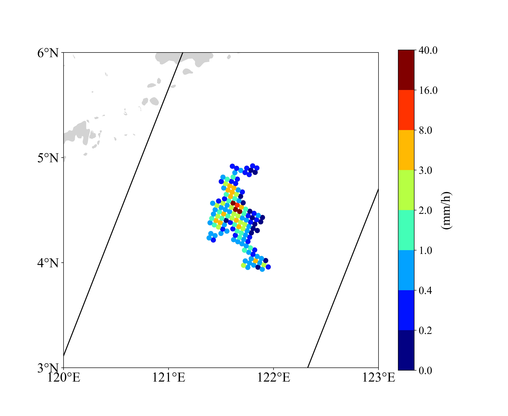

# GPM-DPR Rain Cell

基于 **GPM 2ADPR V07** 近地面降雨率，在卫星扫描网格上识别连续降水区域（雨团，Rain Cluster），并按源文件输出 NetCDF。

项目提供可安装的 Python 包、统一命令行入口和合成数据测试。历史绘图/统计脚本与核心识别流程分离，不再依赖特定服务器目录或固定年份。

## 1. 项目结构

```text
.
├── gpm_raincell/
│   ├── __init__.py          # 公共算法接口
│   ├── __main__.py          # python -m gpm_raincell
│   ├── identify.py          # 区域筛选、时间读取、八邻域 BFS
│   └── batch.py             # HDF5 → 雨团 NetCDF、命令行参数
├── tests/
│   └── test_rain_cell.py    # 核心算法、文件处理和命令行测试
├── examples/legacy/         # 原版绘图/统计脚本，未迁移、未验证
├── Figure/                  # 原仓库示例图片，保留原路径
├── Document/                # GPM 参考资料，保留原路径
├── .github/workflows/       # Windows/Linux 自动化测试
├── DPR_baidrc.py            # 历史命令行入口，仅转发到统一实现
├── DPRtoRCmultiyears.py     # 历史命令行入口，仅转发到统一实现
├── pyproject.toml           # 安装配置、依赖与命令行工具定义
├── requirements.txt         # pip 安装入口，依赖统一来自 pyproject.toml
└── README.md
```

核心包仅负责**单文件/批量雨团识别**，不进行热带低压识别、跨轨道雨团追踪或生命史分析。

## 2. 安装与快速开始

要求 Python **3.10+**。在仓库根目录执行：

```bash
python -m pip install -e .
python -m gpm_raincell --help
```

也可运行 `python -m pip install -r requirements.txt`。依赖为 NumPy、h5py、xarray、netCDF4；写入时明确使用 `netcdf4` 引擎。建议在独立虚拟环境中安装；依赖声明为兼容下限，尚未提供精确版本锁文件。

批量处理：

```bash
python -m gpm_raincell --input "D:/GPM" --output "D:/rc_data"
```

安装后也可从任意目录调用同一个入口：

```bash
gpm-raincell --input "D:/GPM" --output "D:/rc_data"
```

示例路径请替换为本地位置，Linux/macOS 可使用 `/path/to/GPM`。命令不会下载观测数据。

## 3. 雨团判据与识别流程

| 参数 | 默认值 | 含义 |
| --- | --- | --- |
| 降雨率阈值 | `0.5 mm/h` | **大于等于**阈值的有限像元参与识别 |
| 连通方式 | 八邻域 | 扫描行、波束列索引之差均不超过 1，包含对角相邻 |
| 最小像元数 | `4` | 保留**至少 4 个像元**的连通分量 |
| 研究区 | `[95, 145, -5, 35]` | 西、东、南、北边界，包含边界 |
| 区域筛选方式 | 中间波束 | 中间波束位于研究区时，保留**整条扫描行** |

处理步骤：

1. 用中间波束经纬度选择经过研究区的扫描行。
2. 排除未选扫描行、非有限降雨率以及低于阈值的像元。
3. 在**原始扫描网格**上使用 BFS 搜索八邻域连通分量。
4. 丢弃过小分量，其余雨团按行优先发现顺序从 `1` 编号。
5. 输出保留扫描行的雨团标签及物理量。

重要约定：

- 按**网格相邻关系**识别，不是按球面距离聚类；最小像元数不是固定的 km² 面积阈值。
- 整行筛选意味着边缘波束可能位于研究区之外，并参与识别；不是逐像元经纬度裁切。
- 先识别再裁切，避免不连续扫描行压缩后被错误连接；但不额外检查相邻行的实际时间间隔/地理距离。
- `NaN`、正负无穷及低于阈值的降雨值不参与识别。
- 每个源文件独立编号，不跨文件合并或追踪雨团。

## 4. 输入数据

接受单个 `.hdf5` / `.h5` 文件，或递归包含这些文件的目录，扩展名不区分大小写。不会自动解压压缩包。

例如：

```text
GPM/
├── 2020/
│   ├── 001/
│   │   ├── granule_a.HDF5
│   │   └── granule_b.HDF5
│   └── 002/
└── 2021/
```

有有效雨团的文件需要包含以下数据：

| HDF5 路径 | 预期形状 | 用途 |
| --- | --- | --- |
| `FS/Latitude` | `(nscan, nray)` | 纬度 |
| `FS/Longitude` | `(nscan, nray)` | 经度 |
| `FS/SLV/precipRateNearSurface` | `(nscan, nray)` | 近地面降雨率，单位 mm/h |
| `FS/PRE/heightStormTop` | `(nscan, nray)` | 风暴顶高度 |
| `FS/CSF/typePrecip` | `(nscan, nray)` | 原始降水类型编码 |
| `FS/SLV/precipRate` | `(nscan, nray, nbin)` | 降雨率廓线 |
| `FS/SLV/zFactorFinal` | `(nscan, nray, nbin, nfreq)` | 反射率 |
| `FS/SLV/paramDSD` | `(nscan, nray, nbin, nDSD)` | DSD 参数 |
| `FS/ScanTime/Year` | `(nscan,)` | 年 |
| `FS/ScanTime/Month` | `(nscan,)` | 月 |
| `FS/ScanTime/DayOfMonth` | `(nscan,)` | 日 |
| `FS/ScanTime/Hour` | `(nscan,)` | 小时 |

维度长度从数据读取，不再固定为 49 个波束或 176 个垂直层。但字段名和维度顺序仍须符合上述结构；不自动适配其他 GPM 产品、其他版本或单频结构。

## 5. 命令行使用

### 指定年份或单个文件

```bash
python -m gpm_raincell --input "D:/GPM/2020" --output "D:/rc_data/2020"
python -m gpm_raincell --input "D:/GPM/2020/001/granule_a.HDF5" --output "D:/rc_test"
```

### 修改识别参数

```bash
python -m gpm_raincell --input "D:/GPM" --output "D:/rc_custom" --threshold 1.0 --min-pixels 8 --extent 100 130 0 30
```

### 显式覆盖已有输出

```bash
python -m gpm_raincell --input "D:/GPM" --output "D:/rc_data" --overwrite --verbose
```

| 参数 | 说明 |
| --- | --- |
| `--input` | 必填，单个 HDF5 文件或递归搜索目录 |
| `--output` | 必填，输出根目录，自动创建子目录 |
| `--threshold` | 非负有限数值，降雨率阈值，默认 `0.5` |
| `--min-pixels` | 正整数，最小雨团像元数，默认 `4` |
| `--extent` | 西、东、南、北四个数值，默认 `95 145 -5 35` |
| `--overwrite` | 允许重新计算并替换同名输出，默认跳过已有文件 |
| `--verbose` | 文件处理错误时显示完整调用栈 |

经度范围须位于 `[-180, 180]`、纬度范围位于 `[-90, 90]`，且西 ≤ 东、南 ≤ 北。不支持单个范围直接跨越日期变更线。

处理行为：

- 无研究区交集或没有合格雨团：不生成文件。
- 已存在输出：默认跳过。**更改判据时请使用新输出目录或明确指定 `--overwrite`。**
- 单个文件失败：记录错误，继续处理其他文件，结束时汇总四类计数。
- 写入先经过同目录临时文件，成功后才替换目标；失败时保留已有结果并清理临时文件。
- 即使指定 `--overwrite`，本次若没有新识别结果，也**不会删除**已有输出。需要清理旧结果时应另行核对。
- 成功返回码为 `0`；至少一个文件失败为 `1`；无效参数、输入不存在或找不到 HDF5 为 `2`。

## 6. NetCDF 输出

例如输入根目录为 `D:/GPM`、输出根目录为 `D:/rc_data`：

```text
输入：D:/GPM/2020/001/granule_a.HDF5
输出：D:/rc_data/2020/001/granule_a.HDF5.nc
```

保留相对目录，完整源文件名后追加 `.nc`，防止不同颗粒或扩展名发生命名冲突。单文件输入直接写入输出目录。

| 变量 | 维度 | 说明 |
| --- | --- | --- |
| `time` | 标量 | 首个保留扫描行的时间，**截断至小时** |
| `scan_time` | `nscan` | 各保留扫描行的时间，同样截断至小时 |
| `scan_index` | `nscan` | 在源文件中的扫描行索引，从 `0` 开始 |
| `lat`, `lon` | `nscan, nray` | 经纬度 |
| `rcid` | `nscan, nray` | 雨团编号 `1, 2, ...`，背景和被剔除小雨团为 `NaN` |
| `prs` | `nscan, nray` | 近地面降雨率；低于阈值/非有限值为 `NaN` |
| `hst` | `nscan, nray` | 原始风暴顶高度 |
| `typePrecip` | `nscan, nray` | 原始降水类型编码，未解码 |
| `pr3d` | `nscan, nray, nbin` | 降雨率廓线 |
| `R` | `nscan, nray, nbin, nfreq` | 反射率 |
| `dsd` | `nscan, nray, nbin, nDSD` | DSD 参数 |

补充约定：

- `nscan` 等维度坐标为重新从 `0` 编排的索引，原始行号见 `scan_index`。
- 为保留旧时间约定，仅读取年、月、日、小时，**不是分钟/秒精度**。
- 被最小像元数剔除的降雨像元，其 `rcid` 为 `NaN`，但 `prs` 中仍保留有效降雨值。提取已识别雨团请使用 `rcid` 掩码。
- 除近地面降雨率外，其他物理量按原数组保留，不额外清理填充值、转换单位、解码分类或翻转垂直层。请结合对应 GPM 产品文档解释。
- 全局属性记录源文件名、阈值、最小像元数、连通方式、研究区和时间精度。

读取和提取雨团：

```python
import xarray as xr

with xr.open_dataset("D:/rc_data/2020/001/granule_a.HDF5.nc") as ds:
    # 无有效雨团时不会生成文件；因此结果中的最大编号即雨团数量。
    count = int(ds["rcid"].max().item())
    cluster = ds[["lat", "lon", "prs"]].where(ds["rcid"] == 1)
    pixels = int((ds["rcid"] == 1).sum().item())
    print("雨团数量：", count, "；第 1 个雨团的像元数：", pixels)
```

## 7. Python API

```python
import numpy as np
from gpm_raincell import identify_rc
from gpm_raincell.batch import process_file

rain = np.array([[0.5, 0.8, 0.0], [0.6, 1.2, 0.0]])
labels = identify_rc(rain, threshold=0.5, min_pixels=4)
# [[1, 1, 0], [1, 1, 0]]；核心接口使用 0 表示背景。

# 兼容旧函数的原位写入形式，传入同形状的浮点或至少 32 位有符号整数数组。
rcid = np.zeros_like(rain)
identify_rc(rain, rcid)

status = process_file(
    "D:/GPM/2020/001/granule_a.HDF5",
    "D:/rc_test/granule_a.HDF5.nc",
    threshold=0.5,
    min_pixels=4,
    extents=(95, 145, -5, 35),
)
# 返回 "written" / "existing" / "empty"；错误由异常报告。
```

- `identify_rc` 不修改输入降雨数组；指定 `rcid` 时先清零再写入，且不允许它与降雨数组共享内存。
- `region_mask(lat, lon)` 默认返回逐扫描行掩码；`mid=False` 可取得逐像元掩码，但批处理入口固定采用中间波束规则。
- `connect_time(handle)` 返回 `datetime64[h]` 的逐扫描时间。
- `build_dataset(source, ...)` 返回已读入内存的 `xarray.Dataset`，无结果时为 `None`。
- `process_file` 禁止将源文件本身作为输出，以免误覆盖观测数据。

## 8. 旧版迁移说明

两个原命令行文件仍可运行，但必须显式传入路径：

```bash
python DPR_baidrc.py --input "D:/GPM/2020" --output "D:/rc_data/2020"
python DPRtoRCmultiyears.py --input "D:/GPM" --output "D:/rc_data"
```

本次整理：

- 将算法和文件处理拆分为独立模块，依赖集中在 `pyproject.toml`，支持安装后的 `gpm-raincell` 命令。
- 消除重复实现、错误模块导入和硬编码服务器路径/年份；修正“输入目录存在就跳过”的逻辑。
- 导入批处理模块不再触发数据读取；HDF5 句柄自动关闭，输出维度从输入推断。
- 使用队列实现 BFS，保留默认阈值、八邻域和最小像元数判据。
- 修复裁切后不连续扫描行被误连的问题，这类输入的标签可能不同于旧结果。
- 保留主要 NetCDF 变量名，增加溯源信息；**文件名改为源文件名 + `.nc`**，依赖 `orbit*.nc` 的代码需要调整。

旧导入路径（如本地研究代码中的 `RCprocess.RCidentify`）应迁移为 `gpm_raincell.identify`，不再依赖仓库之外的 `RCprocess` 或 `备份代码` 模块。

原 `RCplot.py`、`绘制单个雨团.py`、`统计雨团数量.py` 移至 [`examples/legacy/`](examples/legacy/README.md)，**不属于当前可运行流程**：它们使用旧版 `.npy` 字典、固定路径或缺失的辅助模块，不能直接消费新的 NetCDF 输出。旧脚本中的 `allow_pickle=True` 仅可用于可信来源的数据。

## 9. 历史示例与参考资料



上图为原仓库保留的历史示例，**未用本次实现重新计算**。图片原路径不变；GPM V07 参考 PDF 保留在 [`Document/`](Document/)。当前不提供已整理的绘图命令。

## 10. 测试与验证范围

在仓库根目录执行：

```bash
python -m unittest discover -s tests -p "test_*.py" -v
```

测试使用临时目录和合成 HDF5，不访问网络或真实观测目录，覆盖：

- 阈值边界、八邻域对角连接、最小像元数、连续编号、空数组与非有限值。
- 原位标签写入、非法参数、研究区边界与时间读取。
- 动态维度、原始扫描索引、不连续扫描行隔离及对应物理量对齐。
- NetCDF 写出/重读、已有文件跳过与显式覆盖、无新结果时保留旧文件。
- 写入失败清理、损坏文件隔离、输入文件误覆盖保护。
- 单文件命令行、递归处理及两个历史入口。

GitHub Actions 配置了 Windows/Linux、Python 3.10/3.13 测试矩阵；远程运行结果以 Actions 页面为准。

**尚未使用真实 GPM 轨道文件做科学结果对照或多年批处理性能测试。** 请先用少量真实数据核对雨团数量、空间分布及物理量维度，再开展全量计算。

若环境出现 `numpy.ndarray size changed` 等二进制兼容警告，应检查 NumPy 与 netCDF4 等编译扩展库是否匹配；建议在独立环境重新安装依赖，而不是忽略警告。
